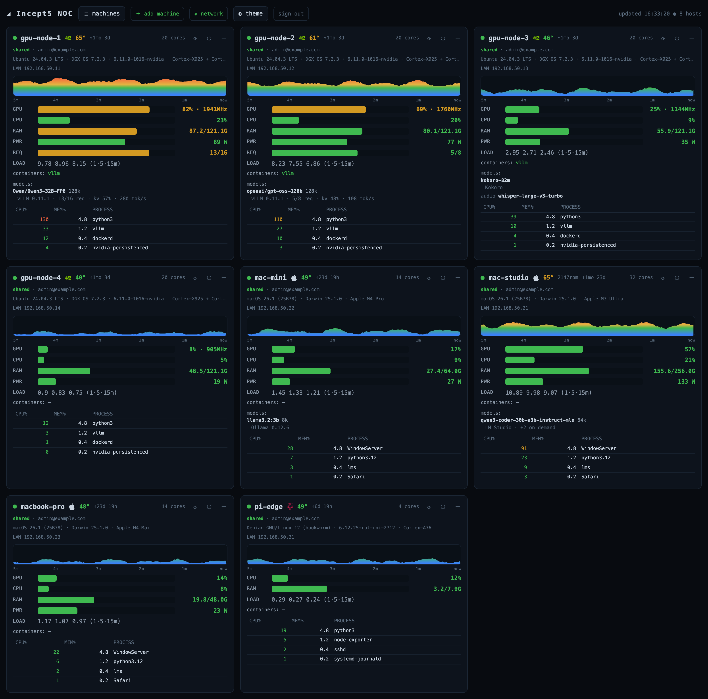
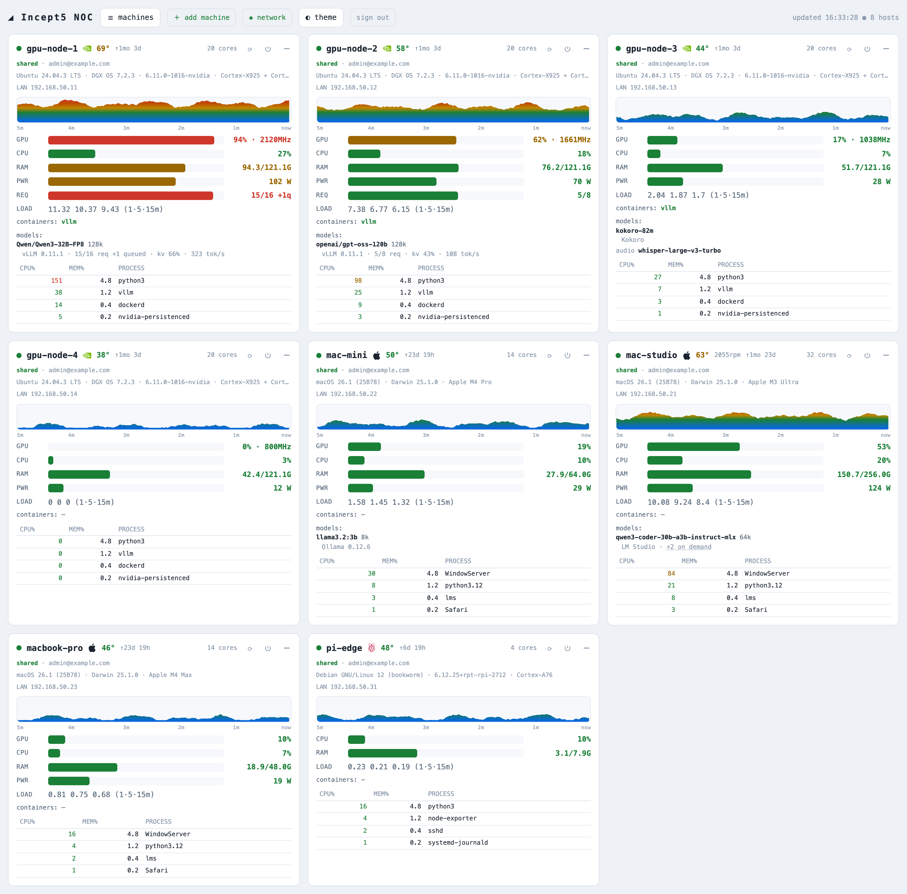
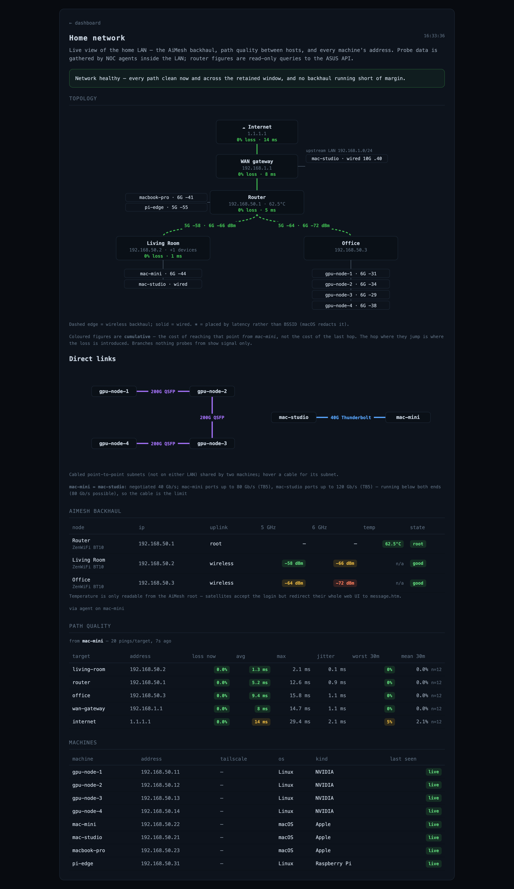
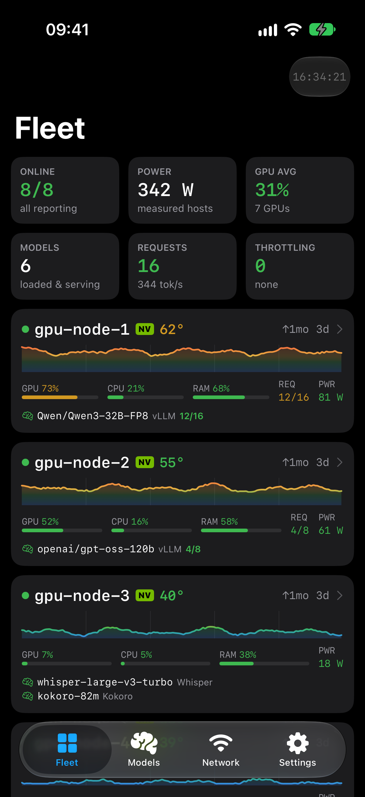
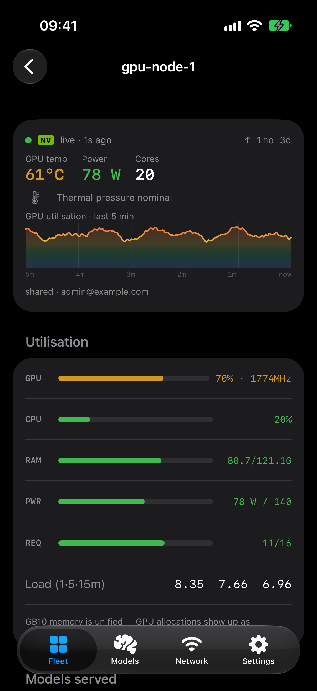
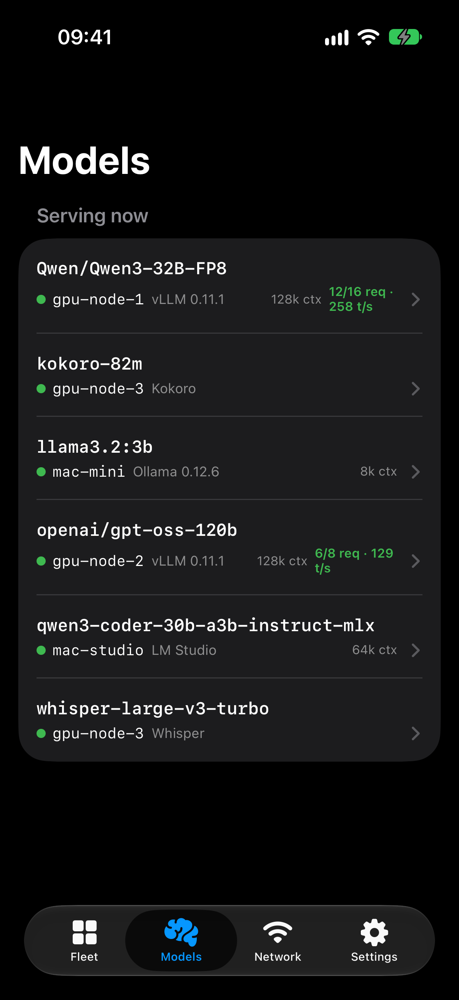
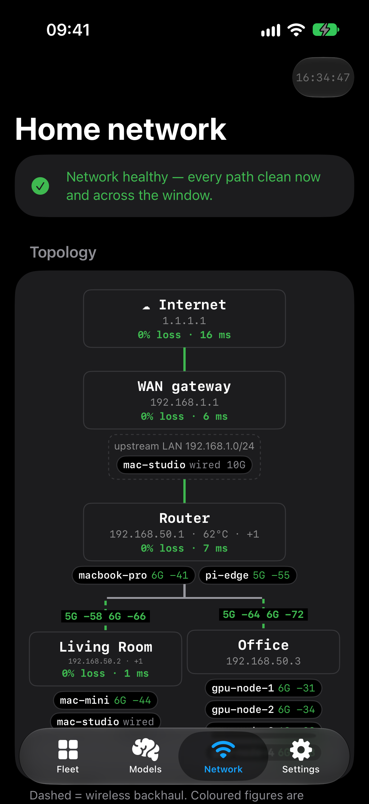
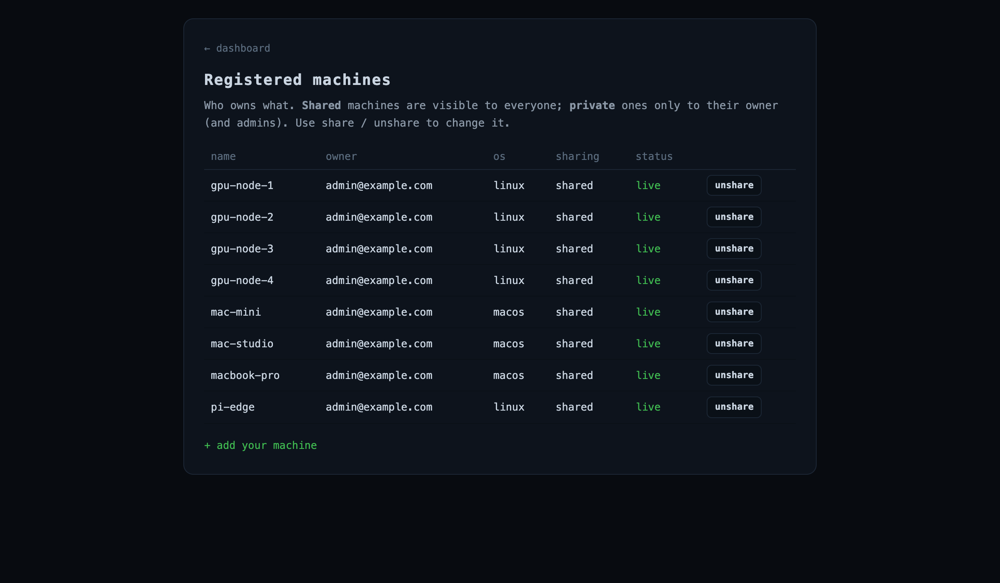

# Fleet NOC

A live NOC-style dashboard for a small, mixed fleet of machines — NVIDIA GPU boxes (DGX Spark /
GB10 and anything with `nvidia-smi`), Apple Silicon Macs and Raspberry Pis — viewable from anywhere,
including a native iPhone app.

Each machine runs a tiny **stdlib-only Python agent** that pushes a sample every 3 s to one central
collector. The collector keeps the latest sample and a rolling 5-minute history per host in memory
and serves a single-page dashboard with no build step and no external assets.



What each card shows:

- **GPU / CPU / RAM / power** meters, a 5-minute sparkline coloured by load, die temperature, fan
  RPM, uptime and the top four processes.
- **Throttling**: thermal pressure on every platform (macOS thermal state, NVIDIA clock-event
  reasons, Raspberry Pi `get_throttled`), shown as an amber or red card border.
- **Served models**: every OpenAI-compatible server on the box (vLLM, SGLang, Ollama, LM Studio,
  llama.cpp, …), found by probing every listening port. vLLM/SGLang add live load: running and
  queued requests against `--max-num-seqs`, KV-cache use and tokens/s.
- **System info**: OS, kernel, CPU, driver/CUDA, agent version.
- **Power control** (owner/admin only, always password-gated): OS reboot/shutdown, plus hardware
  power-cut/cycle through a smart plug when one is mapped.

<p align="center">
  
  
</p>

## iPhone app

A native SwiftUI app (`ios/`) over the same API: fleet totals and cards, a full per-machine detail
view, fleet-wide served models, the admin network page with a native topology diagram, and settings.

<p align="center">
  
  
  
  
</p>

## Try it in one minute (synthetic fleet)

```bash
pip install -r deploy/requirements.txt
python3 demo/demo.py            # http://127.0.0.1:8788
```

`demo/demo.py` runs the real production collector against a throwaway SQLite file and feeds it eight
pretend machines (four GPU nodes on a QSFP line, three Macs, a Pi, a three-node mesh). It prints a
one-time sign-in link for the browser and a session token for the iPhone simulator. No email is
sent; nothing leaves the machine. Every screenshot here was taken from it.

## Architecture

```
 agent (every host)  ──POST /report──▶  collector (noc_web.py)  ◀──GET /metrics (2.5 s)──  browser / iPhone
   noc_agent.py           JSON            STORE: latest + history        HTML from noc_server.PAGE
```

| File | What it is |
|---|---|
| `noc_agent.py` | Cross-platform sampler. **stdlib only**, runs on a bare `python3` (Linux or macOS). `--once` prints one sample and exits. |
| `noc_web.py` | Production collector (FastAPI): `/report` ingest, `/metrics`, magic-link sign-in, self-service enrolment, ownership/sharing, power commands, admin network page. |
| `noc_auth.py` | Magic-link + 6-digit-code auth (SQLite sessions, Amazon SES email), machine registry. |
| `noc_server.py` | Stdlib-only local collector, and **the single source of the dashboard markup** (`PAGE`), which `noc_web.py` imports. |
| `therm.c` `pwr.c` `fan.c` `pressure.m` | Optional rootless macOS sensor helpers: die temperature, SoC power, fan RPM and SMC total power, thermal pressure. |
| `ios/` | SwiftUI iPhone app (XcodeGen project). |
| `deploy/` | systemd unit, nginx vhost, env template, requirements. |
| `demo/demo.py` | Local collector + synthetic fleet. |

The model is **push**, so the collector never needs to reach the machines. It can run in the cloud,
and agents behind NAT on any network just need outbound HTTPS. History is **in memory only**:
restarting the collector clears the sparklines, which refill within about 5 minutes.

### Platform notes

- **NVIDIA**: `nvidia-smi` for utilisation, power, temperature and SM clock. GB10 reports GPU
  memory and power limit as N/A (unified memory), so RAM is the memory metric and power scales
  to a nominal 140 W.
- **macOS**: CPU from `host_processor_info` deltas (ctypes; no `top`, no sudo), memory from
  `vm_stat`, GPU from `ioreg`. Power comes from the first source that answers: battery
  `SystemPowerIn` (laptops), IOReport energy (`pwr`), the SMC total (`fan`; M5-class desktops,
  where IOReport reports only the GPU rail), and finally `sudo -n powermetrics`.
- **Raspberry Pi**: CPU temperature and `vcgencmd get_throttled`.

Build the Mac helpers once per Mac, next to `noc_agent.py` (the agent skips any that are missing):

```bash
clang -O2 -o therm therm.c -framework IOKit -framework CoreFoundation
clang -O2 -fblocks -o pwr pwr.c -framework CoreFoundation
clang -O2 -o fan fan.c -framework IOKit -framework CoreFoundation
clang -O2 -o pressure pressure.m -framework Foundation
```

## Deploying

### Collector

On a small Linux box behind nginx with TLS:

```bash
sudo useradd --system --home /opt/noc noc && sudo mkdir -p /opt/noc
sudo cp noc_web.py noc_auth.py noc_server.py noc_agent.py /opt/noc/   # noc_agent.py is served to installers
sudo python3 -m venv /opt/noc/.venv && sudo /opt/noc/.venv/bin/pip install -r deploy/requirements.txt
sudo cp deploy/env.example /opt/noc/.env && sudo $EDITOR /opt/noc/.env
sudo chown -R noc:noc /opt/noc && sudo chmod 600 /opt/noc/.env
sudo cp deploy/noc.service /etc/systemd/system/ && sudo systemctl enable --now noc
sudo cp deploy/noc.nginx /etc/nginx/sites-available/noc   # set server_name, then certbot --nginx
```

Configuration is all environment (`/opt/noc/.env`, see `deploy/env.example`):

| Variable | Default | Notes |
|---|---|---|
| `APP_BASE_URL` | `http://localhost:8788` | Public origin. Every sign-in link is built from it. |
| `ALLOWED_EMAIL_DOMAINS` | *(empty: nobody)* | Comma-separated. Other domains get a silent no-op, never an error. |
| `ADMIN_EMAILS` | *(empty)* | See every machine, use power controls on any of them, open `/admin`. |
| `NOC_TOKEN` | *(empty)* | Optional shared agent token. Enrolled machines use per-machine tokens instead. |
| `SES_SENDER` / `AWS_REGION` | `noc@example.com` / `eu-west-2` | A verified SES identity. boto3 uses the default credential chain (an instance role is ideal). Leave `AWS_PROFILE` unset: an empty value breaks botocore. |
| `NOC_DB` | `noc.db` beside the module | SQLite: sign-in links, sessions, machines. |
| `COOKIE_SECURE` | `1` | Set `0` only for plain-http local development. |
| `SESSION_TTL_DAYS` / `MAGIC_LINK_TTL_MIN` | `30` / `15` | |
| `MAX_CODE_ATTEMPTS` / `LOGIN_EMAIL_COOLDOWN_S` | `8` / `45` | Code-guess cap and resend throttle. |
| `NOC_AUDIT_LOG` | `power-audit.log` beside the module | Append-only power audit trail. |
| `NOC_MESH_LAN` / `NOC_WAN_LAN` | `192.168.50.0/24` / `192.168.1.0/24` | Network page only: the home LAN and the upstream LAN (double NAT). |

### Adding machines

Sign in, open **＋ add machine** (`/add`), and run the one-line installer it shows. The installer
downloads the agent from the collector and sets it up as a systemd service on Linux or a
LaunchAgent on macOS, with a per-machine token bound to that machine's name. Machines are private
to their owner unless shared at `/machines`; admins see everything.



Manual alternative:

```bash
python3 noc_agent.py --server https://noc.example.com --token <token> --name <host> [--interval 3]
python3 noc_agent.py --once     # print one sample and exit
```

There is no auto-update. To roll out a new agent, copy `noc_agent.py` to the collector first
(`/agent` serves it), then re-fetch it on each host and restart the service.

⚠️ The agent prints its report URL, token included, at startup, so keep its log private.

## Admin network page (`/admin`)

An admin-only view of the home network, for telling a host problem from a network problem:

- **Path quality**: run one agent inside the LAN with
  `--netprobe 'router=192.168.50.1,office=…,wan-gateway=…,internet=1.1.1.1'`. It pings each target
  every 30 s on a background thread. The page keeps 30 minutes of loss history per target, so it
  can tell "fixed" from "quiet right now" on a bursty link.
- **ASUS AiMesh** (optional): add `--asus http://<router>` with `ASUS_USER` / `ASUS_PASS` in the
  agent's environment to read backhaul RSSI, node temperature and the client table. The calls are
  strictly read-only `appGet.cgi` GETs, and the session token is cached so the router UI isn't
  logged out every pass.
- **Topology**, computed server-side so the web page and the app draw the same picture: each
  machine is placed under its mesh node (router client table, then reported BSSID, then latency).
  Private subnets shared by two machines show up as **direct links** (QSFP, Thunderbolt bridge).
  Loss and latency figures are cumulative from the probing host and are labelled that way.

Non-admins get a plain 404, so the page's existence isn't disclosed.

## Power control

Every action requires a password in a modal. It is never stored, and it lives in collector memory
for at most 25 s.

- **Software** (⟳ / ⏻): queued to the box itself, which checks the password with `sudo -S -k` and
  then runs `shutdown -r/-h now`. A wrong password does nothing.
- **Hardware** (⚡⟳ / ⚡⏻): a box can't power-cycle itself, so the command goes to a **relay**: any
  other agent started with `--plug-dir <dir>`. The relay runs `sudo python3 <dir>/plug.py off|cycle
  -n '<plug>'`, and plugs are named in `<dir>/plugs.json` (`{"plugs": {"Name": {...}}}`). Bring
  your own `plug.py` for your smart-plug brand. Machines match plugs by normalised name, so
  `gpu-node-1` matches the plug `GPU Node 1`. The hardware tier also asks you to type the
  machine's name.

Because the collector can't reach agents, commands ride back on the agent's next `/report`
response. Every request and outcome is audit-logged (user, client IP, UTC time, machine, action,
result) to the journal and to `NOC_AUDIT_LOG`. Passwords are never logged.

## iPhone app — build & run

Requires Xcode and [XcodeGen](https://github.com/yonaskolb/XcodeGen). `ios/project.yml` is the
source of truth, and the `.xcodeproj` is generated rather than checked in.

```bash
cd ios && xcodegen generate && open NOC.xcodeproj    # set your team, then Run
```

- **Sign-in** uses the emailed 6-digit code. The app keeps the `noc_session` cookie in the
  Keychain and sends it explicitly. The server URL can be changed on the sign-in screen and in
  Settings.
- **Against the demo in the simulator**, with no email needed:

  ```bash
  xcrun simctl boot "iPhone 17 Pro"
  xcodebuild -project NOC.xcodeproj -scheme NOC -destination 'platform=iOS Simulator,name=iPhone 17 Pro' \
    -derivedDataPath build CODE_SIGNING_ALLOWED=NO build
  xcrun simctl install booted build/Build/Products/Debug-iphonesimulator/NOC.app
  SIMCTL_CHILD_NOC_DEBUG_TOKEN=<session from demo.py> SIMCTL_CHILD_NOC_DEBUG_BASE=http://127.0.0.1:8788 \
    xcrun simctl launch booted com.incept5.noc
  ```

  The debug-only hooks `NOC_DEBUG_TAB=0-3`, `NOC_DEBUG_HOST=<name>` and
  `NOC_DEBUG_SECTION=models|system|procs|power|links` open a specific screen.
- **UI tests** run against a live collector:
  `TEST_RUNNER_NOC_TOKEN=<session> TEST_RUNNER_NOC_BASE=http://127.0.0.1:8788 xcodebuild test -scheme NOC -destination …`
- `ios/install-device.sh` signs and installs onto a device by hand, for when Xcode has no account
  signed in. `python3 ios/icon.py` redraws the app icon.

## Validating changes

There is no test framework. Syntax-check the Python, and remember the dashboard JavaScript lives
inside Python strings: three `<script>` blocks, `PAGE` in `noc_server.py` plus the login and admin
pages in `noc_web.py`.

```bash
python3 -c "import ast; [ast.parse(open(f).read()) for f in ['noc_server.py','noc_agent.py','noc_web.py','noc_auth.py']]"
python3 - <<'EOF'
import re, subprocess, tempfile
for f in ("noc_server.py", "noc_web.py"):
    for i, b in enumerate(re.findall(r"<script>(.*?)</script>", open(f).read(), re.S)):
        t = tempfile.NamedTemporaryFile("w", suffix=".js", delete=False); t.write(b); t.close()
        r = subprocess.run(["node", "--check", t.name], capture_output=True, text=True)
        print(f, i, "ok" if r.returncode == 0 else r.stderr[:200])
EOF
```

Editing the UI means editing `PAGE`, then restarting the collector. `HIST`/`WIN` (history length
and window) are declared separately in `noc_server.py` and `noc_web.py`, so change both together.

## Security notes

- Agents authenticate with a token in the query string, so always run the collector behind TLS.
- `/agent` and `/install.sh` are public by design, so `curl | bash` works before sign-in. They
  carry no secrets: the installer demands `NOC_NAME`/`NOC_TOKEN` from its environment.
- `/api/auth/request` always answers `{ok: true}`, so it can't be used to discover accounts or
  allowed domains.
- Never commit `.env`, `*.db` or `power-audit.log` (already in `.gitignore`).

## License

MIT, see [LICENSE](LICENSE).
